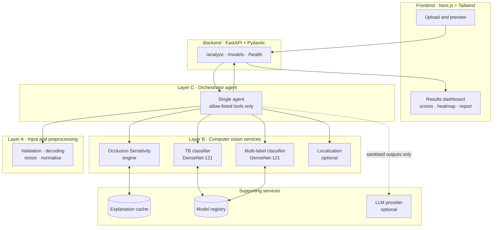
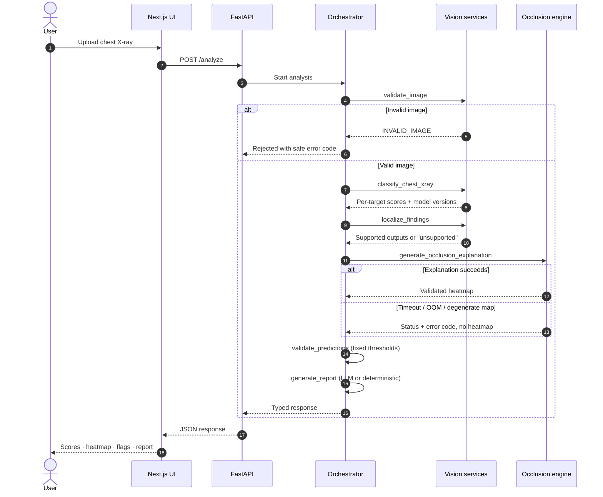
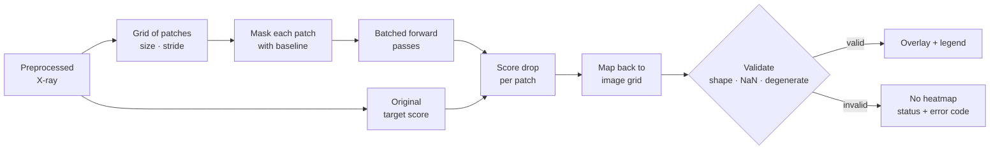
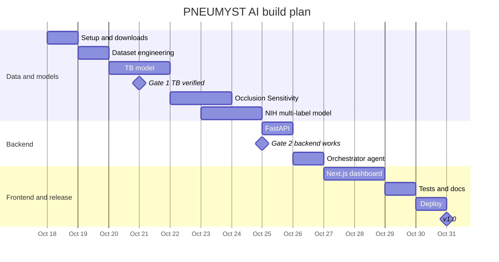

<div align="center">

# 🫁 PNEUMYST AI

### Decoding the unseen.

**A single-agent, explainable chest X-ray screening research platform**

[](https://www.python.org/)
[](https://pytorch.org/)
[](https://fastapi.tiangolo.com/)
[](https://nextjs.org/)
[](https://tailwindcss.com/)
[](#-explainability-occlusion-sensitivity)
[](#-implementation-ledger)
[](#%EF%B8%8F-medical-disclaimer)
[](LICENSE)

[Overview](#-overview) •
[Architecture](#-system-architecture) •
[Workflow](#-analysis-workflow) •
[Datasets](#-datasets) •
[Getting started](#-getting-started) •
[Evaluation](#-evaluation-protocol) •
[Roadmap](#-roadmap) •
[Limitations](#-limitations)

</div>

---

> [!WARNING]
> **PNEUMYST AI is a research prototype, not a medical device.** It is not cleared or approved for clinical use, it does not diagnose disease, and its outputs must be reviewed by a qualified clinician. A high score is not a diagnosis, and a heatmap is not proof of a finding.

---

## 📌 Overview

PNEUMYST AI analyses a chest X-ray and returns **screening scores** for five radiographic targets, a **visual explanation** of which image regions influenced each score, explicit **uncertainty and failure flags**, and a **structured report** for clinician review.

It is built around three engineering principles:

1. **A valid prediction stays available when its explanation fails.**
2. **An unavailable model never becomes a fabricated negative result.**
3. **An attractive heatmap is never mistaken for proof of a medical finding.**

### Screening targets

| # | Target | Model | Training data | Status |
|:-:|---|---|---|:-:|
| 1 | Tuberculosis (TB) | DenseNet-121 (binary) | TBX11K | 🟡 Planned |
| 2 | Pneumonia | DenseNet-121 (multi-label) | NIH ChestX-ray14 | 🟡 Planned |
| 3 | Pneumothorax | DenseNet-121 (multi-label) | NIH ChestX-ray14 | 🟡 Planned |
| 4 | Pleural effusion | DenseNet-121 (multi-label) | NIH ChestX-ray14 | 🟡 Planned |
| 5 | Lung nodule / mass | DenseNet-121 (multi-label) | NIH ChestX-ray14 | 🟡 Planned |

> A nodule or mass score does **not** indicate lung cancer. Each target is a screening signal only.

### Key features

- 🧠 **Trained computer-vision models** do all image analysis; the LLM never invents predictions.
- 🔍 **Occlusion Sensitivity** heatmaps with validation, caching and adaptive GPU batching.
- 🤖 **One orchestrator agent** that sequences six typed, allow-listed tools.
- 🛡️ **Fault tolerance by design**: independent statuses, bounded retries, deadlines, safe error codes.
- 📊 **Honest evaluation** on held-out and external datasets from different hospitals.
- 🖥️ **Clinical-style dashboard** in Next.js that shows uncertainty instead of hiding it.

---

## 🏗 System architecture



| Layer | Responsibility | Key rule |
|---|---|---|
| **A · Input** | Validate, decode, preprocess, record metadata | Reject invalid images before any model runs |
| **B · Vision** | Classification, explanation, optional localization | Models produce every score; nothing is inferred from text |
| **C · Agent** | Sequence tools, gather outputs, compile flags, write report | Cannot change scores, thresholds or evidence |
| **D · API/UI** | Serve and display results | Show heatmaps only when valid; show missing models as unavailable |

---

## 🔄 Analysis workflow



Partial success is a feature: if one model or the explanation fails, every other valid result is still returned with its own status.

---

## 🔍 Explainability: Occlusion Sensitivity

Occlusion Sensitivity estimates how much each image region matters to a score by hiding patches of the image and measuring how the score changes.



| Aspect | Design |
|---|---|
| Grid | Configurable patch size and stride (starting point: 16 × 16 over the model input) |
| Speed | Bounded batches, `torch.inference_mode()`, GPU when available, coarse grid on CPU |
| OOM handling | Halve batch size → bounded retries → coarse-grid fallback (recorded) → optional CPU |
| Deadlines | Separate explanation deadline, cancellation checks between batches |
| Concurrency | Limited explanation jobs so simultaneous uploads cannot exhaust VRAM |
| Cache key | Image hash + model version + target + preprocessing + baseline + patch/stride + algorithm version |
| Validation | Rejects wrong shapes, NaN/Inf, constant maps and stale artifacts |

> A heatmap shows what influenced the **model**, not where disease **is**. Masking can introduce artificial patterns, and results depend on patch size, stride and baseline.

---

## 🛡 Failure handling

Every stage reports its own status, so one failure never hides or fakes another result.

| Stage | Possible statuses |
|---|---|
| Input validation | `success` · `failed` |
| Classification (per target) | `success` · `unavailable` · `timeout` · `failed` |
| Localization | `success` · `unavailable` · `not_requested` |
| Explainability | `success` · `unavailable` · `timeout` · `failed` · `not_requested` |
| Report | `success` (LLM) · `success` (deterministic fallback) · `failed` |

| Error code | Meaning |
|---|---|
| `INVALID_IMAGE` | File could not be decoded or failed validation |
| `MODEL_UNAVAILABLE` | Checkpoint missing or not loaded; never reported as negative |
| `INFERENCE_TIMEOUT` / `INFERENCE_FAILED` | Model call exceeded its deadline or errored |
| `EXPLANATION_TIMEOUT` / `EXPLANATION_OOM` | Heatmap stopped by deadline or GPU memory limits |
| `INVALID_HEATMAP` / `EXPLANATION_DEGENERATE` | Map failed validation or carried no information |

---

## 🗂 Datasets

All datasets are public research datasets. **No images are stored in this repository.** Download each from its official source and accept its terms.

| Dataset | Role | Size | Access | Source |
|---|---|---|---|---|
| **TBX11K** | Train/validate TB model | 11,200 X-rays with TB boxes | Public download | [GitHub](https://github.com/yun-liu/tuberculosis) |
| **NIH ChestX-ray14** | Train/test multi-label model | 112,120 X-rays, 30,805 patients | Public, no registration | [NIH Box](https://nihcc.app.box.com/v/ChestXray-NIHCC) |
| **Shenzhen** | External TB test | 662 X-rays | Public | [NLM](https://data.lhncbc.nlm.nih.gov/public/Tuberculosis-Chest-X-ray-Datasets/) |
| **Montgomery County** | External TB test | 138 X-rays | Public | [NLM](https://data.lhncbc.nlm.nih.gov/public/Tuberculosis-Chest-X-ray-Datasets/) |
| **CheXpert** (validation set) | External test for multi-label model | Radiologist-labelled validation set | Free registration | [Stanford AIMI](https://aimi.stanford.edu/datasets/chexpert-chest-x-rays) |
| **VinDr-CXR** | Optional future external test | — | Credentialed PhysioNet access | [PhysioNet](https://physionet.org/content/vindr-cxr/) |

### Data engineering rules

- Every image keeps its **source, image ID, patient ID, original label, canonical label, annotation type, split, uncertainty flag and label source**.
- **Missing labels are never treated as negative.**
- **Patient-level splits** wherever patient IDs exist; official splits are preferred.
- **Perceptual-hash deduplication** across datasets to prevent leakage.
- TB is trained **only within TBX11K** to avoid learning the hospital instead of the disease.
- NIH labels are NLP-mined from reports and are noisy; this is reported, not hidden.
- `nodule_mass` is defined explicitly as `Nodule OR Mass`.
- TBX11K test labels are held by the authors for an online challenge, so the local test split is carved from the official validation set and documented.

---

## 🧰 Tech stack

| Area | Tools |
|---|---|
| **Machine learning** | Python 3.12 · PyTorch · Torchvision · scikit-learn · NumPy · Pandas · OpenCV · Pillow · Albumentations |
| **Explainability** | Occlusion Sensitivity (NumPy + PyTorch) · Matplotlib overlays |
| **Backend** | FastAPI · Uvicorn · Pydantic · OpenAPI/Swagger |
| **Frontend** | Next.js · React · Tailwind CSS · Recharts |
| **Optional** | Ultralytics YOLOv8 (TB localization) · U-Net (pneumothorax segmentation) |
| **Tooling** | Git · GitHub · Antigravity · VS Code |
| **Deployment** | Vercel (frontend) · Hugging Face Spaces / Render (backend, CPU) |

**Reference hardware:** Windows, NVIDIA RTX 3050 (4 GB VRAM). Training and inference are configured for limited GPU memory with mixed precision and adaptive batch sizes.

---

## 📁 Project structure

```text
pneumyst-ai/
├── frontend/                 # Next.js dashboard
│   ├── app/                  # pages: upload, results
│   ├── components/           # viewer, score cards, status chips, report
│   ├── lib/                  # API client
│   └── types/                # TypeScript mirrors of backend schemas
├── backend/
│   ├── app/
│   │   ├── api/              # FastAPI routes
│   │   ├── agents/           # single orchestrator + tool registry
│   │   ├── core/             # config, logging, limits
│   │   ├── schemas/          # Pydantic request/response models
│   │   ├── services/         # inference, explanation, report
│   │   ├── models/           # model registry and loaders
│   │   └── utils/
│   ├── tests/                # unit, integration, API, failure-path tests
│   └── requirements.txt
├── ml/
│   ├── configs/              # versioned training + threshold configs
│   ├── datasets/             # dataset loaders + canonical label mapping
│   ├── preprocessing/        # validation, resizing, manifests, dedupe
│   ├── training/             # training loops with safe checkpointing
│   ├── evaluation/           # metrics, calibration, external tests
│   ├── inference/            # standalone inference utilities
│   └── checkpoints/          # local only, git-ignored
├── docs/                     # architecture, model cards, evaluation, limitations
├── .env.example
├── .gitignore
└── README.md
```

---

## 🚀 Getting started

> Setup steps are added as each stage lands. Commands marked *planned* describe the intended interface.

### Prerequisites

- Python 3.12
- NVIDIA GPU with a recent driver (optional but recommended for training)
- Node.js 18+ (for the frontend)
- About 60 GB of free disk space for raw datasets (about 10 GB after preprocessing)

### 1. Clone and create the environment

```powershell
git clone https://github.com/Fy1zN/pneumyst-ai.git
cd pneumyst-ai
python -m venv .venv
.\.venv\Scripts\Activate.ps1          # Windows PowerShell
# source .venv/bin/activate           # macOS / Linux
```

Install PyTorch with the CUDA build matching your driver from [pytorch.org](https://pytorch.org/get-started/locally/), then:

```powershell
pip install -r backend/requirements.txt
```

### 2. Configure

```powershell
Copy-Item .env.example .env
```

Set `DATA_ROOT` in `.env` to a folder **outside** the repository.

### 3. Download and preprocess data *(planned)*

```powershell
python -m ml.preprocessing.build_manifests --dataset tbx11k
python -m ml.preprocessing.build_manifests --dataset nih
```

### 4. Train *(planned)*

```powershell
python -m ml.training.train --config ml/configs/tb_densenet121.yaml
python -m ml.training.train --config ml/configs/nih_multilabel_densenet121.yaml
```

### 5. Run the backend *(planned)*

```powershell
uvicorn backend.app.main:app --reload
```

API docs: `http://localhost:8000/docs`

### 6. Run the frontend *(planned)*

```powershell
cd frontend
npm install
npm run dev
```

App: `http://localhost:3000`

---

## 🔌 API

| Method | Endpoint | Description |
|---|---|---|
| `GET` | `/health` | Service health and model load status |
| `GET` | `/models` | Registered models, versions and availability per target |
| `POST` | `/analyze` | Upload an X-ray; returns scores, explanation status, flags and report |
| `GET` | `/artifacts/{id}` | Retrieve a validated, short-lived heatmap artifact |

Uploaded images are **not stored by default**, and internal file paths are never exposed.

---

## 📏 Evaluation protocol

| Task | Metrics |
|---|---|
| Classification | AUROC · AUPRC · sensitivity · specificity · precision · F1 · confusion matrix · calibration · bootstrap CIs |
| External generalisation | Same metrics on Shenzhen, Montgomery and CheXpert validation |
| Explainability | Repeatability · sensitivity to baseline and grid · score drop when top regions are occluded · overlap with TBX11K boxes · latency · peak memory · failure rate |
| Localization *(optional)* | mAP@0.5 · mAP@0.5:0.95 · Dice · IoU |

Thresholds are chosen on validation data only and stored in version-controlled config. Test sets are never used for model selection.

### Results

> **No results yet.** This table is filled only with metrics from completed, reproducible runs.

| Model | Test set | AUROC | AUPRC | Sensitivity | Specificity |
|---|---|:-:|:-:|:-:|:-:|
| TB · DenseNet-121 | TBX11K (local test) | — | — | — | — |
| TB · DenseNet-121 | Shenzhen + Montgomery | — | — | — | — |
| Multi-label · DenseNet-121 | NIH official test | — | — | — | — |
| Multi-label · DenseNet-121 | CheXpert validation | — | — | — | — |

---

## 🗺 Roadmap



---

## ✅ Implementation ledger

| Feature | Status |
|---|:-:|
| Repository skeleton | ✅ Implemented |
| Environment and GPU check | ⏳ In progress |
| Dataset manifests and canonical labels | ⬜ Not started |
| TB classifier | ⬜ Not started |
| NIH multi-label classifier | ⬜ Not started |
| Occlusion Sensitivity engine | ⬜ Not started |
| Explanation cache and fallbacks | ⬜ Not started |
| Orchestrator agent and tools | ⬜ Not started |
| FastAPI endpoints | ⬜ Not started |
| Next.js dashboard | ⬜ Not started |
| Test suite (18 required cases) | ⬜ Not started |
| Deployment | ⬜ Not started |
| Localization (optional) | ⬜ Not started |

Statuses move through **Not started → In progress → Implemented → Tested → Verified in running app**. A feature is never marked complete just because code exists.

---

## ⚠️ Limitations

- Trained on public research data; performance on other hospitals, devices and populations is unknown until externally validated.
- NIH ChestX-ray14 labels were extracted from reports by NLP and contain errors, especially for pneumonia.
- Models may learn shortcuts (for example, chest drains for pneumothorax); heatmaps are used to check for this but cannot rule it out.
- Occlusion Sensitivity is a model-attribution aid, not a causal explanation and not clinical evidence.
- No prospective or clinical validation has been performed.

## ⚕️ Medical disclaimer

PNEUMYST AI is for **research and education only**. It is not intended to diagnose, treat, cure or prevent any disease, and must not be used for clinical decision-making. Always consult a qualified healthcare professional.

---

## 🙏 Acknowledgements and citations

- **NIH ChestX-ray14** — data provided by the NIH Clinical Center. Download site: <https://nihcc.app.box.com/v/ChestXray-NIHCC>.
  Wang X. et al., *ChestX-ray8: Hospital-scale Chest X-ray Database and Benchmarks on Weakly-Supervised Classification and Localization of Common Thorax Diseases*, CVPR 2017.
- **TBX11K** — Liu Y. et al., *Rethinking Computer-aided Tuberculosis Diagnosis*, CVPR 2020.
- **Shenzhen and Montgomery** — Jaeger S. et al., *Two public chest X-ray datasets for computer-aided screening of pulmonary diseases*, Quant Imaging Med Surg, 2014. Provided by the U.S. National Library of Medicine.
- **CheXpert** — Irvin J. et al., *CheXpert: A Large Chest Radiograph Dataset with Uncertainty Labels and Expert Comparison*, AAAI 2019. Data provided by the Stanford Center for Artificial Intelligence in Medicine and Imaging (AIMI); see the AIMI dataset page for the required acknowledgement wording.

## 📄 License

Code in this repository is released under the [MIT License](LICENSE). Datasets are **not** included and remain under their own licenses and terms of use.

---

<div align="center">

Built with care for honest, explainable medical AI research.

</div>