<div align="center">

# 🫁 PNEUMYST AI

### Decoding the unseen.

**A single-agent, explainable chest X-ray screening research platform**

[](https://www.python.org/)
[](https://pytorch.org/)
[](https://fastapi.tiangolo.com/)
[](https://nextjs.org/)
[](https://tailwindcss.com/)
[](https://clerk.com/)
[](https://www.mysql.com/)
[](https://developers.cloudflare.com/r2/)
[](#-explainability-occlusion-sensitivity)
[](#-implementation-ledger)
[](#%EF%B8%8F-medical-disclaimer)
[](LICENSE)

[Overview](#-overview) •
[Architecture](#-system-architecture) •
[Workflow](#-analysis-workflow) •
[Data & privacy](#-accounts-data-and-privacy) •
[Reports](#-screening-report-and-audit-trail) •
[Datasets](#-datasets) •
[Data findings](#-data-findings-eda) •
[Model results](#-model-results) •
[Getting started](#-getting-started) •
[Evaluation](#-evaluation-protocol) •
[Roadmap](#-roadmap) •
[Limitations](#-limitations)

</div>

---

> [!WARNING]
> **PNEUMYST AI is a research prototype, not a medical device.** It is not cleared or approved for clinical use, it does not diagnose disease, and its outputs must be reviewed by a qualified clinician. A high score is not a diagnosis, and a heatmap is not proof of a finding.

---

## 📌 Overview

PNEUMYST AI analyses a chest X-ray and returns **screening scores** for **15 chest X-ray findings**, a **visual explanation** of which image regions influenced each score, explicit **uncertainty and failure flags**, and a **structured report** for clinician review. Signed-in users keep a private **history** of their analyses.

It is built around three engineering principles:

1. **A valid prediction stays available when its explanation fails.**
2. **An unavailable model never becomes a fabricated negative result.**
3. **An attractive heatmap is never mistaken for proof of a medical finding.**

### Screening targets: 15 chest findings

| Group | Finding | Model | Training data | Test AUROC |
|---|---|---|---|:-:|
| **Infection** | Tuberculosis | DenseNet-121 (binary, separate model) | TBX11K | 0.891 Shenzhen · 0.744 Montgomery (v2) |
| | Pneumonia | DenseNet-121 (14-label) | NIH ChestX-ray14 | 0.722 |
| | Consolidation | DenseNet-121 (14-label) | NIH ChestX-ray14 | 0.743 |
| | Infiltration | DenseNet-121 (14-label) | NIH ChestX-ray14 | 0.696 |
| **Pleura** | Effusion | DenseNet-121 (14-label) | NIH ChestX-ray14 | 0.826 |
| | Pneumothorax | DenseNet-121 (14-label) | NIH ChestX-ray14 | 0.863 |
| | Pleural thickening | DenseNet-121 (14-label) | NIH ChestX-ray14 | 0.781 |
| **Lung tissue** | Atelectasis | DenseNet-121 (14-label) | NIH ChestX-ray14 | 0.772 |
| | Edema | DenseNet-121 (14-label) | NIH ChestX-ray14 | 0.850 |
| | Emphysema | DenseNet-121 (14-label) | NIH ChestX-ray14 | 0.926 |
| | Fibrosis | DenseNet-121 (14-label) | NIH ChestX-ray14 | 0.825 |
| | Nodule | DenseNet-121 (14-label) | NIH ChestX-ray14 | 0.762 |
| | Mass | DenseNet-121 (14-label) | NIH ChestX-ray14 | 0.825 |
| **Heart and other** | Cardiomegaly | DenseNet-121 (14-label) | NIH ChestX-ray14 | 0.894 |
| | Hernia | DenseNet-121 (14-label) | NIH ChestX-ray14 | 0.901 · too few validation cases |

Two models produce all 15 scores: a TB specialist trained on TBX11K, and one multi-label model that outputs all 14 NIH findings in a single pass. Because they are trained on different data, the TB score is not directly comparable with the NIH scores. NIH figures are on the official NIH test set (25,588 images); TB figures are on external hospitals the model never trained on. Full results: [Model results](#-model-results).

> These are radiographic findings, not diagnoses. A nodule or mass score does **not** indicate lung cancer, and a tuberculosis score does not confirm TB.

### Calibrated scores and result bands

Raw model scores are not probabilities: class weighting inflated the NIH scores 3–20× and TB v1 output almost only 0 or 1. Every score is therefore **calibrated** (Platt scaling), and each finding gets **two thresholds**, all fitted on validation data only and frozen in version-controlled config ([`ml/configs/`](ml/configs/)) before any test set is evaluated.

| Band | Rule | Meaning |
|---|---|---|
| 🟢 **Unlikely** | score below the *possible* threshold | ruled out at the screening operating point |
| 🟡 **Possible: review** | between the two thresholds | the model cannot tell; clinician review |
| 🔴 **Likely** | score at or above the *likely* threshold | flagged |

- *Possible* threshold: catches at least **90% of positives** on validation (yellow + red).
- *Likely* threshold: at most **10% of negatives** turn red on validation, so red stays rare and meaningful.
- The calibrated score is always shown next to the band, so a red flag for a rare finding (e.g. "6%") is read in proportion.
- **Hernia** is marked `insufficient_data` (15 validation positives) and shows no band. Weaker findings (Infiltration, Pneumonia, Nodule) carry a lower-reliability note.

### Key features

- 🩻 **15 chest findings** across infection, pleura, lung tissue and heart, with calibrated scores and honest unlikely / possible / likely bands.
- 🧠 **Trained computer-vision models** do all image analysis; the LLM never invents predictions.
- 🔍 **Occlusion Sensitivity** heatmaps with validation, caching and adaptive GPU batching.
- 🤖 **A tool-calling assistant agent** (OpenAI or Gemini) that writes report summaries and answers questions about saved results through allow-listed, read-only tools. The screening itself is a fixed, audited pipeline.
- 🛡️ **Fault tolerance by design**: independent statuses, bounded retries, deadlines, safe error codes.
- 🔐 **Secure accounts** with Clerk; every analysis is private to the user who created it.
- 🗄️ **Persistent history** in MySQL, with heatmaps in a private Cloudflare R2 bucket.
- 📄 **Downloadable Screening Analysis Report (PDF)** and a machine-readable **audit record (JSON)** for every analysis.
- 📊 **Honest evaluation** on held-out and external datasets from different hospitals.
- 🖥️ **Clinical-style dashboard** in Next.js that shows uncertainty instead of hiding it.

---

## 🏗 System architecture

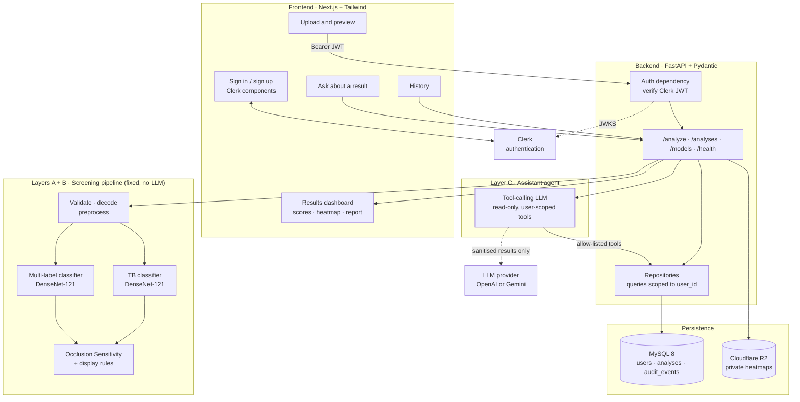

| Layer | Responsibility | Key rule |
|---|---|---|
| **A · Input** | Validate, decode, preprocess, record metadata | Reject invalid images before any model runs |
| **B · Vision** | Classification, calibration, bands and explanation | Models produce every score; nothing is inferred from text |
| **C · Agent** | Write the report summary and answer questions about saved results, using allow-listed, read-only tools | Never runs in the screening path; cannot change scores, thresholds or evidence; falls back to a template |
| **D · API/UI** | Authenticate, serve, persist and display results | Every request is tied to a verified user; missing models show as unavailable |

**Why the screening is not run by the agent:** the steps are always the same, so letting an LLM choose them could only make results less predictable. The screening is a fixed pipeline with per-stage statuses; the agent works on its saved output, where language helps (summaries and questions) and where every tool call is logged.

---

## 🔄 Analysis workflow

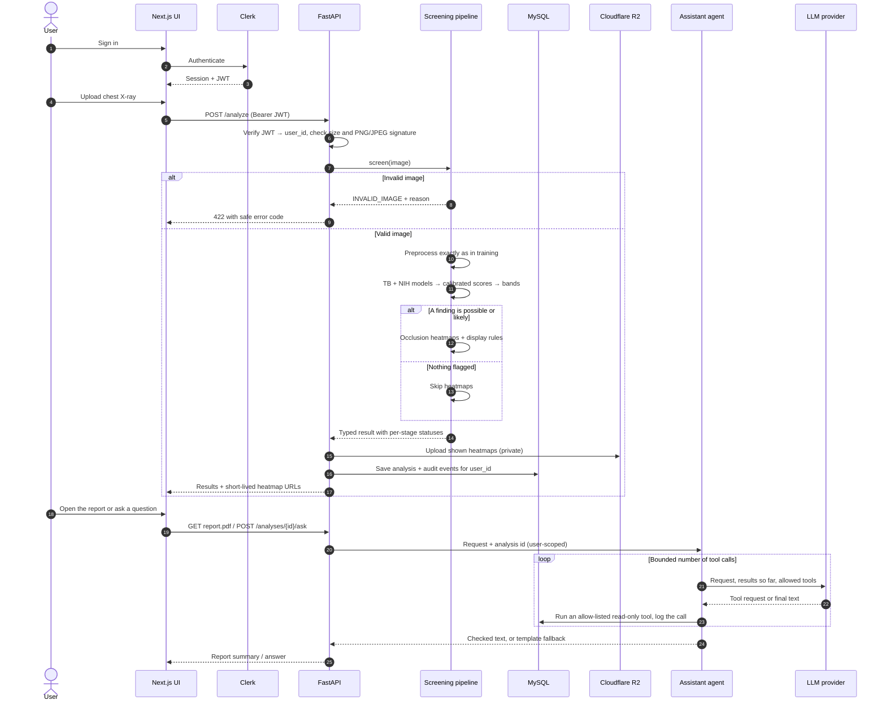

Partial success is a feature: if one model or the explanation fails, every other valid result is still returned and saved with its own status.

---

## 🔍 Explainability: Occlusion Sensitivity

Occlusion Sensitivity estimates how much each image region matters to a score by hiding patches of the image and measuring how the **calibrated** score changes. One pass explains all 14 NIH findings at once; the TB model gets its own pass.

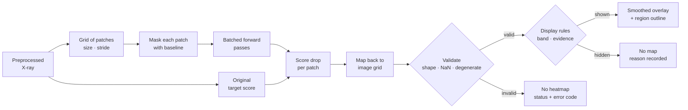

| Aspect | Design |
|---|---|
| Grid | 32 × 32 px patches, stride 16, over the 320 px input (361 occluded copies per image) |
| Baseline | Heavily blurred copy of the image (σ = 12). Black squares were avoided because they look like the padding the models were trained on |
| Score | Drop in **calibrated** score, so maps are comparable across findings |
| Speed | Occluded copies built on the GPU in batches of 32, `torch.inference_mode()`, mixed precision: **≈ 1.45 s per image** on the RTX 3050, **0.44 GB** peak memory |
| OOM handling | Halve the batch size, up to 3 retries, then return status `out_of_memory` with the scores but no map |
| Validation | Rejects wrong shapes, NaN/Inf and constant maps |
| Code | [`ml/explain/occlusion.py`](ml/explain/occlusion.py), checks in [`notebooks/explain.ipynb`](notebooks/explain.ipynb), 10 unit tests |
| *Planned (backend)* | Explanation deadline and cancellation, limited concurrent jobs, cache keyed on image hash + model version + settings |

### Do the heatmaps show what the model uses?

Checked on the NIH v1 model with the 984 radiologist-drawn boxes in the official NIH test set ([summary](docs/figures/explain/occlusion_summary.json)):

| Finding | Boxes | Hottest spot inside the box | Chance (box area share) | Lift |
|---|--:|:-:|:-:|:-:|
| Cardiomegaly | 146 | **86%** | 18% | 4.8× |
| Infiltration | 123 | 51% | 10% | 5.2× |
| Pneumonia | 120 | 49% | 10% | 5.1× |
| Effusion | 153 | 41% | 7% | 5.8× |
| Mass | 85 | 38% | 4% | 8.7× |
| Nodule | 79 | 27% | 0.6% | 47× |
| Atelectasis | 180 | 23% | 3% | 6.9× |
| Pneumothorax | 98 | 18% | 5% | 3.4× |
| **All** | **984** | **43%** | **8%** | **5.6×** |

<p align="center">
  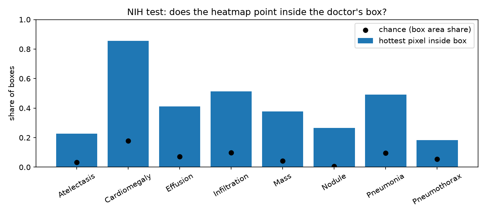
</p>

- **Faithful:** hiding the hottest 10% of the image lowers the score by **0.189** on average, against **0.049** for a random 10% of similar shape; the heatmap wins in **99%** of 120 test images.
- **Moderately stable:** changing the patch size (24 or 48 px) or the fill (mean instead of blur) keeps the overall pattern (median Spearman 0.74–0.77), but the single hottest spot lands in the same region only about half the time. Maps are therefore shown as **regions**, never as an exact point.
- **No AP-view border shortcut found for Edema:** the share of heat in the outer image frame is lower on AP images (0.15) than PA (0.19), and both are far below the 0.42 expected if heat were spread evenly.
- **TB v2 on Montgomery:** on TB cases it catches, the heat sits on the upper lobes, where TB usually appears. On missed cases the model often looks at the right area but its score stays too low, so the Montgomery gap is a threshold and sensitivity problem rather than the model looking in the wrong place.
- **Weakest localization:** Pneumothorax and Atelectasis. The Pneumothorax heat tends to spread over the whole lung rather than the collapse line.

### What the app shows

Maps at low scores are mostly noise, and stretching each map to its own maximum painted that noise bright red (for example along the image border on TB cases the model scored near 0). The display rules below were set on these checks and then frozen:

| Rule | Setting |
|---|---|
| Only findings in the **possible** or **likely** band get a map | Unlikely findings and Hernia (`insufficient_data`) show no map |
| Hide the map when nothing strongly supports the score | No region removes at least 5% of the score |
| Smooth the 16 px patch grid | Gaussian, σ = 8 px |
| Colour scale | The map's own peak, but never less than 25% of the score, so weak evidence stays faint |
| Region outline | Area at least half as hot as the peak |

With these rules, 96% of the 984 boxed findings still get a map (they are real positives), the outlined region touches the radiologist's box in **82%** of them, and the median region covers 5% of the image.

> A heatmap shows what influenced the **model**, not where disease **is**. Masking can introduce artificial patterns, and results depend on patch size, stride and baseline.

---

## 🧪 Inference utility

[`ml/inference/screener.py`](ml/inference/screener.py) is the single entry point the backend calls:

```python
screener = Screener.load()           # once: both checkpoints + their frozen calibration configs
result = screener.screen("cxr.png")  # per image; bad input or a failing model never raises
result.to_dict()                     # JSON for the API, report and audit record
```

| Step | What happens |
|---|---|
| Input check | Decodes PNG/JPEG (16-bit scaled like the training data); rejects unreadable, tiny, huge, very elongated or blank images with `INVALID_IMAGE` and a reason |
| Preprocessing | The same `preprocess_array()` as training (trim, pad, 320 px); its version and transform are recorded |
| Scores and bands | One pass per model → 15 calibrated scores → unlikely / possible / likely from the frozen thresholds (Hernia: score, no band) |
| Heatmaps | Occlusion only when a model has a possible or likely finding, then the [display rules](#what-the-app-shows); every finding gets a map or a reason |
| Statuses | Per stage and per model, so one failure never hides or fakes another result (see [Failure handling](#-failure-handling)) |

**Parity check** ([`notebooks/inference.ipynb`](notebooks/inference.ipynb)): 250 test images (150 NIH, 50 Montgomery, 50 Shenzhen) were run from their **raw files** through `screen()` and compared with the evaluation pipeline.

| Check | Result |
|---|---|
| Preprocessing identical to the stored training images | 100% |
| Largest score difference (fp16 rounding, single image vs batch) | 0.0007 |
| Same band | 99.95% (2 of 3,750 results, both on a threshold) |
| Time per image, RTX 3050 | 111 ms without heatmaps · about 2 s with heatmaps |

The scores reported in [Model results](#-model-results) are therefore the scores the app produces. The utility does not check that an image is a chest X-ray; any image that passes the input check is scored.

---

## 🛡 Failure handling

Every stage reports its own status, so one failure never hides or fakes another result.

| Stage | Possible statuses |
|---|---|
| Input validation | `success` · `failed` |
| Classification (per target) | `success` · `unavailable` · `timeout` · `failed` |
| Localization | `success` · `unavailable` · `not_requested` |
| Explainability | `success` · `unavailable` · `timeout` · `failed` · `not_requested` |
| Report | `success` (LLM) · `success` (deterministic fallback) · `failed` |
| Persistence | `saved` · `not_saved` (result still returned to the user) |

| Error code | Meaning |
|---|---|
| `INVALID_IMAGE` | File could not be decoded or failed validation |
| `MODEL_UNAVAILABLE` | Checkpoint missing or not loaded; never reported as negative |
| `INFERENCE_TIMEOUT` / `INFERENCE_FAILED` | Model call exceeded its deadline or errored |
| `EXPLANATION_TIMEOUT` / `EXPLANATION_OOM` | Heatmap stopped by deadline or GPU memory limits |
| `INVALID_HEATMAP` / `EXPLANATION_DEGENERATE` | Map failed validation or carried no information |
| `EXPLANATION_FAILED` | Heatmap stopped by any other error; the scores are still returned |
| `UNAUTHENTICATED` / `FORBIDDEN` | Missing or invalid token, or access to another user's analysis |
| `STORAGE_FAILED` | Heatmap upload or database write failed; analysis result is still returned |

---

## 🔐 Accounts, data and privacy

| Component | Service | Stores |
|---|---|---|
| Authentication | **Clerk** | User identity and sessions; passwords never touch our backend |
| Database | **MySQL 8** | Users and analysis records: scores, statuses, flags, report, model versions |
| File storage | **Cloudflare R2** (private bucket) | Heatmap overlays; original X-rays only if the user opts in |

### Database tables

| Table | Key columns |
|---|---|
| `users` | `id` (Clerk user ID, `VARCHAR(64)`), `email`, `consent_accepted_at`, `created_at` |
| `analyses` | `id` (`CHAR(36)` UUID), `user_id`, `created_at`, `model_versions` (JSON), `scores` (JSON), `statuses` (JSON), `flags` (JSON), `report` (TEXT), `report_source` (`llm` / `deterministic`), `case_context` (JSON, nullable, user-entered), `heatmap_key`, `image_key` (nullable), `image_hash` |
| `audit_events` | `id`, `analysis_id`, `step`, `tool`, `status`, `error_code`, `latency_ms`, `config` (JSON), `fallback_used`, `created_at` |

All tables use `utf8mb4`, timestamps are stored in UTC, and schema changes go through Alembic migrations.

### Privacy rules

- **Results are saved by default; X-rays are not.** The original image is stored only if the user explicitly chooses to save it.
- **Users only see their own data.** Every query is filtered by the verified `user_id`, and tests check that one user cannot read another user's analysis.
- **Private storage only.** Heatmaps are served through presigned URLs that expire within minutes.
- **Consent at sign-up.** Users confirm they will upload only de-identified or public research images.
- **PNG/JPEG only.** DICOM is not accepted, so no patient metadata arrives in file headers.
- **Real deletion.** Deleting an analysis removes its database row and its stored files.
- **Nothing identifiable goes to the LLM.** Only sanitised scores and statuses are sent, and only when the LLM is enabled.

---

## 📄 Screening report and audit trail

Every analysis can be exported in two forms. Neither contains patient-identifying information, and **no patient details are ever generated by AI**.

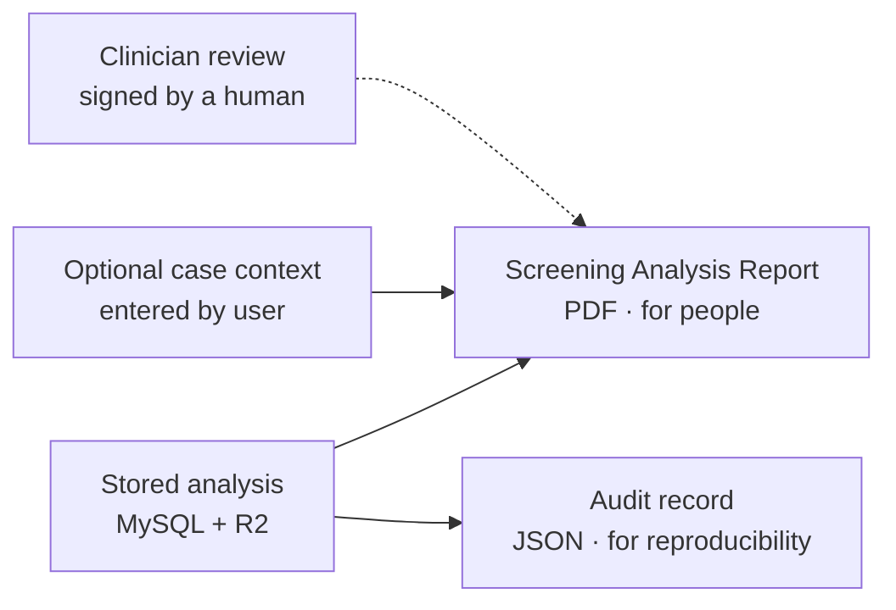

### Screening Analysis Report (PDF)

| Section | Contents |
|---|---|
| Header | "Research Screening Analysis — not a diagnostic report", analysis ID, date/time (UTC) |
| Case context *(optional)* | Age band, sex, reason for X-ray, entered by the user and labelled **"provided by user, not used by the models"** |
| Image | Thumbnail, heatmap overlay with legend, dimensions, format, image hash |
| Results | Per-target score, validated threshold, above/below threshold, status |
| Explanation | Target explained, method, grid settings, any fallback used |
| Flags | Low-confidence results, unavailable models, quality warnings |
| Summary | Report text generated only from the results above (LLM or deterministic template) |
| Limitations | Research-use statement and known limitations |
| Clinician review | Blank fields for reviewer name, decision, signature and date |

**Never included:** name, patient ID, date of birth, exact address, phone number or any field filled in by AI.

### Audit record (JSON)

Analysis ID, user ID, timestamps, image hash, model names, versions and checkpoint hashes, preprocessing configuration, thresholds used, every tool call with status, latency and error code, explanation settings and fallbacks, and whether the summary came from the LLM or the deterministic template. Any result in the PDF can be traced back to the exact computation that produced it.

---

## 🗂 Datasets

All datasets are public research datasets. **No images are stored in this repository.** Download each from its official source and accept its terms.

| Dataset | Role | Size | Usable after cleaning | Access | Source |
|---|---|---|---|---|---|
| **TBX11K** | Train / val / test for the TB model | 11,200 X-rays with TB boxes | **8,248** (5,479 / 977 / 1,792) | Public download | [GitHub](https://github.com/yun-liu/tuberculosis) |
| **NIH ChestX-ray14** | Train / val / test for the 14-finding model | 112,120 X-rays, 30,805 patients | **112,093** (77,335 / 9,170 / 25,588) | Public, no registration | [NIH Box](https://nihcc.app.box.com/v/ChestXray-NIHCC) |
| **Shenzhen** | External TB test | 662 X-rays | **662** (336 TB) | Public | [NLM](https://data.lhncbc.nlm.nih.gov/public/Tuberculosis-Chest-X-ray-Datasets/) |
| **Montgomery County** | External TB test | 138 X-rays | **138** (58 TB) | Public | [NLM](https://data.lhncbc.nlm.nih.gov/public/Tuberculosis-Chest-X-ray-Datasets/) |
| **CheXpert** | Future work: external test for the NIH findings | Distributed only as a 471 GB archive | — | Free registration | [Stanford AIMI](https://aimi.stanford.edu/datasets/chexpert-chest-x-rays) |
| **VinDr-CXR** | Future work: radiologist-labelled external test for both models | — | — | Credentialed PhysioNet access | [PhysioNet](https://physionet.org/content/vindr-cxr/) |

**121,141 usable images** in total, after removing duplicates and leaked copies. TBX11K's own test set (hidden labels) and its bundled extra images are not used.

### Data engineering rules

- Every image keeps its **source, image ID, patient ID, original label, canonical label, annotation type, split, uncertainty flag and label source**.
- **Missing labels are never treated as negative.**
- **Patient-level splits** wherever patient IDs exist; official splits are preferred.
- **Exact and perceptual-hash deduplication** (256-bit pHash, ≤ 6 bits apart) within and across datasets; one copy of every duplicate is kept, and the copy in the more important split (external test > test > val > train) wins. NIH's 112k images are searched with a banded hash index that is exhaustive at this threshold.
- Every skipped or removed image is logged with a reason; nothing is dropped silently.
- TB is trained **only within TBX11K** to avoid learning the hospital instead of the disease.
- NIH labels are NLP-mined from reports and are noisy; this is reported, not hidden.
- All 14 NIH findings are kept exactly as labelled; Nodule and Mass stay separate findings.
- Labels are never shared across datasets: TBX11K images have no NIH labels, which means **unknown**, not negative.
- NIH has no uncertainty labels; an absent finding means "not mentioned in the report", which is documented as label noise.
- TBX11K test labels are held by the authors for an online challenge, so the local test split is carved from the official validation set and documented.

---

## 📊 Data findings (EDA)

A 23-section exploratory analysis ([`notebooks/eda.ipynb`](notebooks/eda.ipynb), charts in [`docs/figures/eda/`](docs/figures/eda/)) checked every dataset before any model was trained. Sample X-rays are shown in the notebook for visual validation; the charts in `docs/figures/eda/` are aggregate only.

### Data-quality problems found and fixed

| Problem | Scale | Fix |
|---|---|---|
| TBX11K images duplicated across its official train / val / test split | 72 images | Removed from the less important split |
| TBX11K images duplicated within a split | 80 images | One copy kept |
| NIH images filed under **two different patient IDs**, one copy in train and one in test | 3 images | Train copies removed |
| Other NIH duplicates (same patient re-filed, or same split) | 24 images | One copy kept |
| Shenzhen palette images with **inverted colour tables** | 108 of 227 sampled | Always converted through the palette |
| "Label conflicts" in Shenzhen / Montgomery readings | 7 → **0** | Were typos (`femal`, `female24yrs`, `normale`); parser fixed |

After cleaning, a full re-scan of all 112,093 NIH images finds **zero** remaining duplicate pairs.

Also checked and needing no fix:

- **NIH "suspected inverted" images** (12 of 400 sampled) were reviewed by hand; all are correctly oriented. They were flagged because of bright, unexposed areas outside the collimated field, not inversion.
- **TBX11K "uncertain TB" category** (`PulmonaryTuberculosis`) has **0** images in the train / val lists, so no uncertain labels need special handling.

### Risks the models must be tested against

| Risk | Evidence | Mitigation |
|---|---|---|
| 🔴 **TBX11K acquisition shortcut** | A linear model on brightness, contrast, sharpness and borders alone separates healthy vs TB with **AUROC 0.976** (healthy vs sick 0.985). Percentile normalization and CLAHE do not reduce it. | Photometric and blur augmentation during TB training; external test as the primary TB score; metrics within sharpness / brightness bands; heatmap review |
| 🟠 **AP-view shortcut** | Edema is **11× more common on AP than PA** images (3.9% vs 0.3%); consolidation 2.8× | AUROC reported separately for AP and PA images |
| 🟠 **Hospital fingerprints** | Each dataset is 99–100% identifiable from global image statistics, with or without normalization | External test reported separately; domain shift documented |
| 🟡 **Sicker official NIH test set** | Pneumothorax 3.0% in train vs 10.4% in test; AP views 35% → 57% | Explained by follow-up scans (below); thresholds chosen on validation only |
| 🟡 **Rare findings** | Hernia: 126 train, **15 validation** positives | Hernia marked insufficient data; bands decided on validation |
| 🟠 **Padding mismatch (TB)** | After preprocessing, only **0.2%** of TBX11K images are padded, versus **97%** of Shenzhen and **100%** of Montgomery | Random black padding / shift augmentation during TB training |
| 🟠 **Sharpness gap (TB)** | Median sharpness at 320 px: TBX11K **99**, Shenzhen **299**, Montgomery **515** | Random blur and sharpen augmentation during TB training |

<p align="center">
  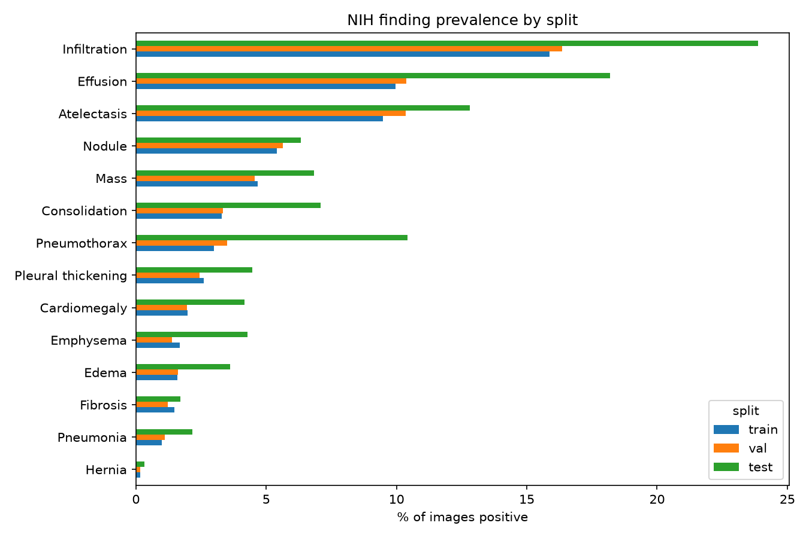
  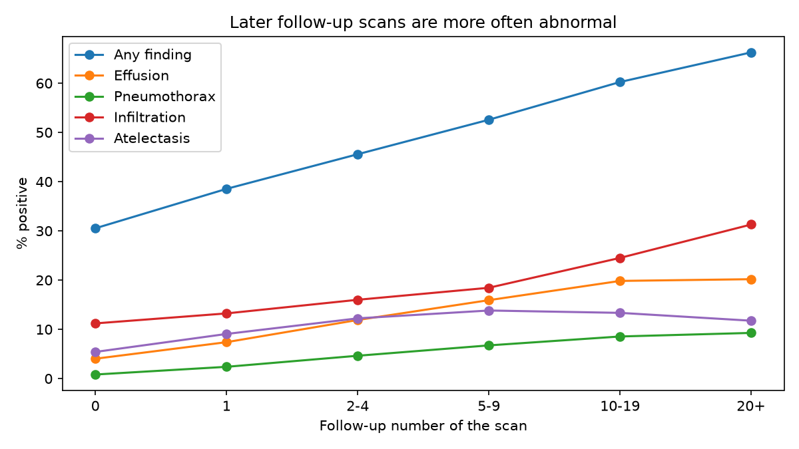
</p>

**Why the NIH test set is sicker:** the share of abnormal scans rises from **31% on a patient's first scan to 66% by the 20th+**, and the official test set averages **9.2 scans per patient** versus 3.1 in train.

<p align="center">
  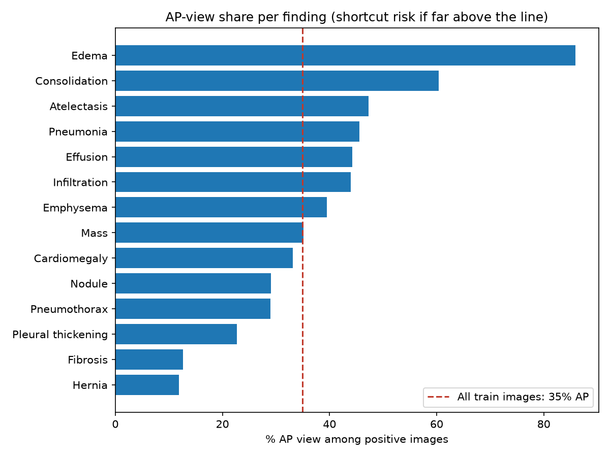
  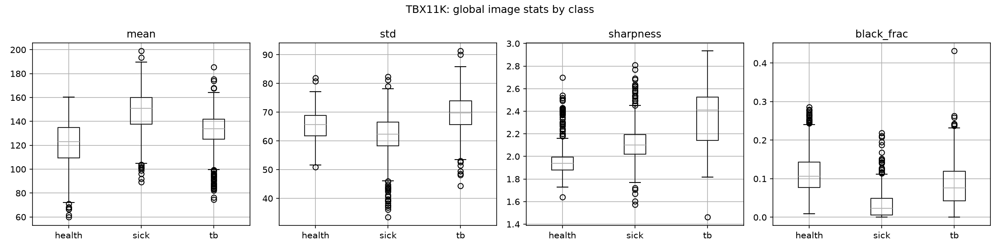
</p>

### Other findings

- **Formats:** NIH has 519 RGBA images, Shenzhen 635 palette + 27 RGB, TBX11K is all RGB, Montgomery grayscale. Every colour-mode image is genuinely grayscale (channel difference 0, fully opaque).
- **Shapes and sizes:** NIH 1024² and TBX11K 512² are square; Shenzhen (989–3001 px) and Montgomery (4020–4892 px, aspect 0.82, ~12% flat border) are not.
- **Lesion size:** NIH nodule boxes have a median side of **15 px at 224 px input vs 22 px at 320 px**; the smallest is 6 px.
- **Co-occurrence:** 43% of edema images also carry infiltration, 38% of pneumonia images too, and 36% of cardiomegaly images carry effusion.
- **Demographics:** NIH ~56% male, median age 49; Shenzhen 68% male, median 33 (31 children); Montgomery 54% female, median 40 (17 children); TBX11K has no demographics.
- **Image quality:** starting thresholds for the app's quality check are sharpness < 34.7 and mean brightness outside 83–175 (1st / 99th percentiles), used as **warnings**, not rejections.

### Preprocessing decisions

| Step | Setting | Based on |
|---|---|---|
| Decode | PIL → 8-bit grayscale; palette images through their palette | Formats, inversion check |
| Borders | Trim perfectly flat rows / columns | Border check (Montgomery) |
| Shape | Pad to square, never stretch | Size and aspect check |
| Size | Long side **320 px**; images larger than 512 px are first reduced to 512 px so all sources pass through the same resampling | Lesion-size check, resolution gap (Montgomery ~4000 px) |
| Intensity | Stored as-is; fixed ImageNet mean / std at load time; no CLAHE | Shortcut and fingerprint probes |
| Records | Crop, padding and scale saved per image (NIH boxes are mapped onto the 320 px images); per-image brightness, contrast and sharpness saved for shortcut checks | Bounding-box use, evaluation within quality bands |

**Preprocessing result:** all **121,141** images processed with **0 failures** (TBX11K 8,248 · NIH 112,093 · Shenzhen 662 · Montgomery 138). Flat borders were trimmed in 92 of 138 Montgomery images and 13,235 NIH images.

---

## 📈 Model results

Both models are DenseNet-121 (ImageNet weights) at 320 px, trained on an RTX 3050 (4 GB) with mixed precision. Model choice, calibration and thresholds use validation data only; each test set was run **once** afterwards.

### NIH 14-finding model (v1)

Best epoch 7 of 10 (validation mean AUROC 0.829, early stop after overfitting began). **Official NIH test set: mean AUROC 0.813** across 14 findings.

| Finding | Test positives | Val AUROC | **Test AUROC** (95% CI) | AP | PA | Caught (yellow + red) | Positives in red | Negatives in red | Red PPV |
|---|--:|:-:|:-:|:-:|:-:|:-:|:-:|:-:|:-:|
| Emphysema | 1,093 | 0.895 | **0.926** (0.918–0.933) | 0.934 | 0.913 | 97% | 88% | 16% | 20% |
| Hernia ⚠️ | 86 | 0.847 | **0.901** (0.855–0.941) | 0.778 | 0.918 | 98% | 83% | 12% | 2% |
| Cardiomegaly | 1,069 | 0.912 | **0.894** (0.885–0.903) | 0.856 | 0.935 | 90% | 75% | 13% | 20% |
| Pneumothorax | 2,664 | 0.842 | **0.863** (0.857–0.870) | 0.848 | 0.863 | 98% | 76% | 19% | 32% |
| Edema | 924 | 0.883 | **0.850** (0.838–0.860) | 0.779 | 0.847 | 96% | 79% | 24% | 11% |
| Effusion | 4,656 | 0.898 | **0.826** (0.819–0.831) | 0.796 | 0.860 | 94% | 72% | 23% | 41% |
| Mass | 1,748 | 0.849 | **0.825** (0.815–0.836) | 0.801 | 0.843 | 95% | 69% | 18% | 22% |
| Fibrosis | 435 | 0.797 | **0.825** (0.805–0.842) | 0.821 | 0.785 | 94% | 53% | 11% | 8% |
| Pleural thickening | 1,143 | 0.775 | **0.781** (0.769–0.793) | 0.780 | 0.759 | 97% | 59% | 20% | 12% |
| Atelectasis | 3,278 | 0.820 | **0.772** (0.765–0.780) | 0.761 | 0.788 | 94% | 44% | 12% | 34% |
| Nodule | 1,621 | 0.782 | **0.762** (0.750–0.774) | 0.751 | 0.773 | 96% | 49% | 14% | 19% |
| Consolidation | 1,815 | 0.813 | **0.743** (0.733–0.754) | 0.692 | 0.728 | 95% | 58% | 24% | 16% |
| Pneumonia | 555 | 0.770 | **0.722** (0.699–0.742) | 0.700 | 0.712 | 95% | 48% | 19% | 5% |
| Infiltration | 6,110 | 0.718 | **0.696** (0.689–0.703) | 0.678 | 0.599 | 96% | 56% | 27% | 40% |

⚠️ Hernia: only 15 validation positives, so it is marked `insufficient_data` and shows no band in v1, even though its test result is good.

- **Strong:** Emphysema, Cardiomegaly, Pneumothorax, Edema (≥ 0.85). **Weakest:** Infiltration (0.696, 0.599 on PA images) and Pneumonia (0.722), consistent with their noisy NLP-mined labels.
- **Test vs validation:** the official test set is sicker (57% AP vs 36%, about 9 scans per patient). Effusion, Consolidation and Atelectasis drop 0.05–0.07; Emphysema, Pneumothorax and Fibrosis rise.
- **Calibration holds on test:** calibrated averages match observed rates (e.g. Effusion 0.181 vs 0.182) with calibration error ≤ 0.038.

<p align="center">
  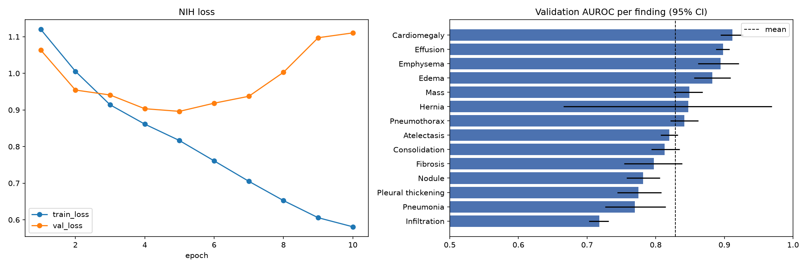
</p>

### TB model: v1 → v2

TB v1 reached AUROC 0.998 on TBX11K but was overconfident (scores almost only 0 or 1) and weaker at other hospitals. Its own validation set was saturated at 1.000, so it could not guide improvements. TB v2 changed four things:

1. **Model selection on Shenzhen-dev**: Shenzhen was split once, 50/50 by TB label ([`ml/configs/tb_shenzhen_split.csv`](ml/configs/tb_shenzhen_split.csv)); the dev half picks the epoch, the test half is reported. Montgomery stays untouched.
2. **Label smoothing (0.1)** so scores cannot run to exactly 0 or 1.
3. **Wider augmentation**: stronger contrast / gamma, random CLAHE and random low resolution, on top of padding, blur / sharpen and photometric changes.
4. **Calibration and bands fitted on Shenzhen-dev** ([`ml/configs/tb_v2_calibration.json`](ml/configs/tb_v2_calibration.json)).

| Test set | Model | AUROC (95% CI) | Calibration error | TB caught | Healthy flagged red |
|---|---|:-:|:-:|:-:|:-:|
| Shenzhen-test (331) | v1 (threshold 0.5) | 0.802 (0.756–0.845) | 0.300 | 95% | **67%** (109) |
| Shenzhen-test (331) | **v2** | **0.891** (0.855–0.923) | **0.047** | 89% | **6%** (10) |
| Montgomery (138) | v1 (threshold 0.5) | 0.666 (0.569–0.759) | 0.284 | 57% | 34% (27) |
| Montgomery (138) | **v2** | **0.744** (0.650–0.826) | 0.251 | **38%** | 1% (1) |
| TBX11K test (1,792) | v1 / v2 | 0.998 / 0.996 | 0.008 / 0.030 | 92% / 93% | 0.1% / 0.1% |

**Decision rule, set before testing:** v2 replaces v1 if, on Montgomery, AUROC is higher, calibration error lower and false reds no higher. All three held, so **v2 is the TB model**.

- v2 is clearly better on Shenzhen-test (the confidence intervals barely overlap) and its scores are no longer all-or-nothing.
- On Montgomery v2 ranks better (not statistically proven with 138 images) and raises almost no false alarms, but **catches only 38% of TB**: Shenzhen-tuned thresholds do not transfer to a very different hospital. See [Limitations](#-limitations).

<p align="center">
  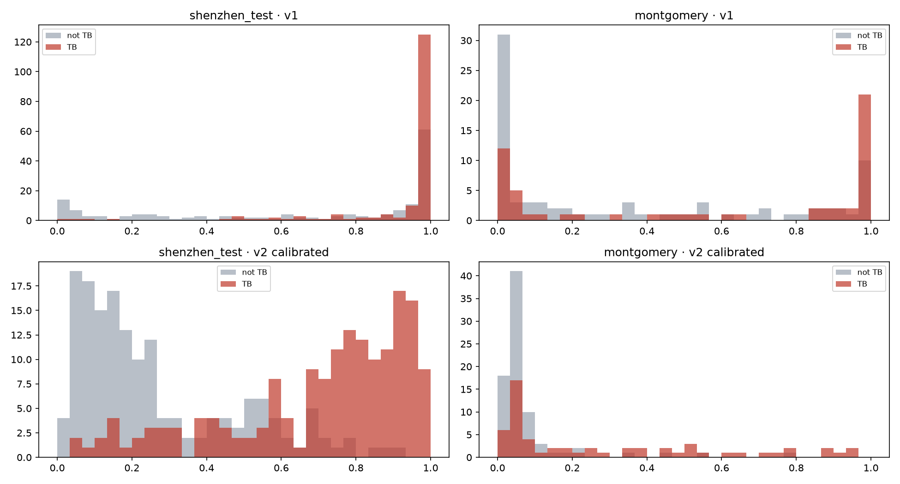
</p>

### Training notes

- **Speed:** the `channels_last` memory format made DenseNet-121's backward pass about 10× slower on this GPU (8 vs 82 images/s). Removing it brought NIH epochs from about 2.7 hours to about 19 minutes.
- **Checkpoints:** `best.pt` (selected epoch) and `last.pt` (resume) per run in `ml/checkpoints/`, git-ignored.

---

## 🧰 Tech stack

| Area | Tools |
|---|---|
| **Machine learning** | Python 3.12 · PyTorch · Torchvision · scikit-learn · NumPy · Pandas · OpenCV · Pillow · Albumentations |
| **Explainability** | Occlusion Sensitivity (NumPy + PyTorch) · Matplotlib overlays |
| **Backend** | FastAPI · Uvicorn · Pydantic · OpenAPI/Swagger |
| **Authentication** | Clerk (Next.js components · JWT verification via JWKS in FastAPI) |
| **Database** | MySQL 8 · SQLAlchemy 2.0 · PyMySQL · Alembic migrations |
| **Object storage** | Cloudflare R2 (S3-compatible) · boto3 · presigned URLs |
| **Reports** | ReportLab (PDF) · JSON audit records |
| **LLM and agent** | OpenAI or Gemini with tool calling (provider set in `.env`) · hand-written tool loop or LangGraph (decided when the agent is built) |
| **Frontend** | Next.js · React · Tailwind CSS · Recharts · `@clerk/nextjs` |
| **Optional** | Ultralytics YOLOv8 (TB localization) · U-Net (pneumothorax segmentation) |
| **Tooling** | Git · GitHub · Antigravity · VS Code |
| **Deployment** | Vercel (frontend) · Hugging Face Spaces / Render (backend, CPU) · hosted MySQL (e.g. Aiven) · Cloudflare R2 |

**Reference hardware:** Windows, NVIDIA RTX 3050 (4 GB VRAM). Training and inference are configured for limited GPU memory with mixed precision and adaptive batch sizes.

---

## 📁 Project structure

```text
pneumyst-ai/
├── frontend/                 # Next.js dashboard (created with create-next-app)
│   ├── app/                  # pages: sign-in, sign-up, upload, results, history
│   ├── components/           # viewer, score cards, status chips, report
│   ├── lib/                  # API client (attaches Clerk token)
│   └── types/                # TypeScript mirrors of backend schemas
├── backend/
│   ├── app/
│   │   ├── api/              # FastAPI routes: health, models, analyze (analyses, report, ask planned)
│   │   ├── agent/            # assistant agent: tool-calling loop + allow-listed tools (planned)
│   │   ├── auth/             # Clerk JWT verification → current user
│   │   ├── core/             # settings from .env, API errors
│   │   ├── db/               # SQLAlchemy engine, session, table models
│   │   ├── repositories/     # database queries, always scoped to user_id
│   │   ├── storage/          # Cloudflare R2 client, presigned URLs (planned)
│   │   ├── reporting/        # PDF report builder + JSON audit export (planned)
│   │   ├── schemas/          # Pydantic response models
│   │   ├── services/         # screening pipeline: upload checks, one GPU job at a time
│   │   └── main.py           # app factory, models loaded once at startup
│   ├── migrations/           # Alembic migrations (planned)
│   └── tests/                # API tests with toy models
├── ml/
│   ├── configs/              # versioned training + threshold configs
│   ├── datasets/             # manifest builders, label mapping, dedupe
│   ├── eda/                  # EDA charts, data checks, shortcut probes
│   ├── preprocessing/        # trim, pad, resize, per-image stats
│   ├── training/             # training loops with safe checkpointing
│   ├── evaluation/           # metrics, calibration, external tests
│   ├── explain/              # Occlusion Sensitivity heatmaps, checks and display rules
│   ├── inference/            # Screener: one X-ray → 15 calibrated findings + heatmaps
│   ├── tests/                # data, EDA, preprocessing, training, heatmap and inference tests
│   └── checkpoints/          # local only, git-ignored
├── notebooks/                # eda, preprocessing, train, explain, inference (sample X-rays kept for visual validation)
├── docs/                     # EDA figures, architecture, model cards, limitations
├── .env.example
├── .gitignore
├── requirements.txt
└── README.md
```

---

## 🚀 Getting started

> Setup steps are added as each stage lands. Commands marked *planned* describe the intended interface.

### Prerequisites

- Python 3.12
- NVIDIA GPU with a recent driver (optional but recommended for training)
- Node.js 18+ (for the frontend)
- MySQL 8 (local install for development)
- Free accounts on [Clerk](https://clerk.com/) and [Cloudflare](https://dash.cloudflare.com/) (for R2)
- About 50 GB of free disk space for the raw datasets, plus ~10 GB for processed images

### 1. Clone and create the environment

```powershell
git clone https://github.com/Fy1zN/pneumyst-ai.git
cd pneumyst-ai
python -m venv .venv
.\.venv\Scripts\Activate.ps1          # Windows PowerShell
# source .venv/bin/activate           # macOS / Linux
```

Install PyTorch with the CUDA build matching your driver from [pytorch.org](https://pytorch.org/get-started/locally/), then:

```powershell
pip install -r requirements.txt
```

### 2. Set up MySQL

```sql
CREATE DATABASE pneumyst CHARACTER SET utf8mb4 COLLATE utf8mb4_0900_ai_ci;
CREATE USER 'pneumyst'@'localhost' IDENTIFIED BY 'change-me';
GRANT ALL PRIVILEGES ON pneumyst.* TO 'pneumyst'@'localhost';
```

### 3. Configure

```powershell
Copy-Item .env.example .env
```

Fill in `.env`:

- `DATA_ROOT`: a folder **outside** the repository.
- `DATABASE_URL`: your MySQL connection string. Use a password of letters and digits, or URL-encode characters such as `@`, `:` and `/`.
- `LLM_PROVIDER` (`openai` or `gemini`), `LLM_API_KEY`, `LLM_MODEL`: optional, for report summaries and the assistant *(planned)*.
- `CLERK_SECRET_KEY`, `CLERK_JWKS_URL`, `CLERK_ISSUER`: from your Clerk application. `CLERK_AUTHORIZED_PARTIES`: the frontend origins allowed to send tokens (default `http://localhost:3000`).
- `AUTH_MODE`: `clerk` (default) verifies every request. `dev` skips verification and uses `DEV_USER_ID`, for local work only; never use it when deployed.
- `R2_*`: your R2 bucket name, endpoint and API token.

The frontend uses its own `frontend/.env.local` with `NEXT_PUBLIC_CLERK_PUBLISHABLE_KEY` and the API URL.

### 4. Create the database tables

```powershell
alembic -c backend/alembic.ini upgrade head
```

### 5. Build the dataset manifests

Download the datasets into `DATA_ROOT/raw/` (`tbx11k/`, `nih-cxr14/`, `shenzhen/`, `montgomery/`), then:

```powershell
python -m pytest ml/tests -q
python -m ml.datasets.build_manifests --hash-nih
```

This validates every image, builds leak-free splits and writes manifests, duplicate reports and a summary to `DATA_ROOT/processed/manifests/`. `--hash-nih` fingerprints all NIH images once (~15 min) and caches the result.

### 6. Explore the data

Open `notebooks/eda.ipynb` with the `.venv` kernel and run all cells. Charts are saved to `docs/figures/eda/`.

### 7. Preprocess images

```powershell
python -m ml.preprocessing.preprocess
```

This trims flat borders, pads to square and resizes every image to 320 px, writing them to `DATA_ROOT/processed/images_320/` and per-image records to `DATA_ROOT/processed/manifests/<dataset>_processed.csv`. It resumes where it stopped if interrupted; use `--overwrite` after rebuilding the manifests.

### 8. Train and evaluate

Open `notebooks/train.ipynb` (`.venv` kernel) and run its sections in order: setup, NIH model, TB v2. Each training cell resumes from `ml/checkpoints/<run>/last.pt` if interrupted. A command-line entry point is also available:

```powershell
python -m ml.training.train --task nih --epochs 10 --batch-size 16 --accum 2
python -m ml.training.train --task tb --epochs 12 --batch-size 16 --accum 2
```

The notebook adds what the CLI does not: the TB v2 Shenzhen-dev selection, calibration and bands, and the one-time test evaluations. Checkpoints are git-ignored; keep a backup of each `best.pt`.

### 9. Check the heatmaps

Open `notebooks/explain.ipynb` (`.venv` kernel). Cells 1–3 load both models and show a gallery; the box-overlap cell makes maps for all 880 boxed NIH test images (about 20–30 minutes the first time) and caches them in `DATA_ROOT/processed/explain/cache/`, so later cells and reruns are fast. Aggregate results go to `docs/figures/explain/`; X-ray figures stay in the data folder.

### 10. Check the inference utility

Open `notebooks/inference.ipynb` (`.venv` kernel) and run its three cells: load both models, the parity check from raw files (a few minutes; it should print `PARITY PASS`), and one full result with heatmaps.

### 11. Run the backend

From the repository root (both `best.pt` files must be in `ml/checkpoints/`):

```powershell
uvicorn backend.app.main:app
```

The models load once at startup. `http://localhost:8000/health` shows the device and model status, and `http://localhost:8000/docs` lets you try every endpoint. Optional settings in `.env`: `MODEL_DEVICE` (`auto`, `cpu` or `cuda`), `MAX_UPLOAD_MB` (default 20), `QUEUE_TIMEOUT_S` (default 60), `CORS_ORIGINS`.

### 12. Run the frontend *(planned)*

```powershell
cd frontend
npm install
npm run dev
```

App: `http://localhost:3000`

---

## 🔌 API

Every endpoint except `/health` requires a valid Clerk session token: `Authorization: Bearer <token>`. A missing or invalid token returns `401 UNAUTHENTICATED`; if Clerk's signing keys cannot be fetched the API returns `503 AUTH_UNAVAILABLE`. Each user only ever sees their own analyses; another user's analysis returns `404`. Errors always return `{"error_code", "detail", "analysis_id"}` and never internal details.

| Method | Endpoint | Description | Status |
|---|---|---|:-:|
| `GET` | `/health` | Service health, device and model load status | ✅ |
| `GET` | `/models` | Models, checkpoint SHA-256, availability, per-finding thresholds and band status | ✅ |
| `POST` | `/analyze` | Upload a PNG/JPEG X-ray (`?explain=false` skips heatmaps); returns 15 findings with scores, bands, statuses and timings; saves the result | ✅ |
| `GET` | `/analyses` | The signed-in user's analysis history (paged, flagged findings) | ✅ |
| `GET` | `/analyses/{id}` | One past analysis (short-lived heatmap URLs planned) | ✅ |
| `DELETE` | `/analyses/{id}` | Delete an analysis and its audit events (stored files planned) | ✅ |
| `GET` | `/analyses/{id}/report.pdf` | Download the Screening Analysis Report | Planned |
| `GET` | `/analyses/{id}/audit.json` | Download the audit record | Planned |
| `POST` | `/analyses/{id}/ask` | Ask the assistant agent about one saved analysis | Planned |

`/analyze` returns `413 FILE_TOO_LARGE`, `422 INVALID_IMAGE` (with a reason such as `unsupported_format` or `blank_image`), `503 MODEL_UNAVAILABLE` / `SERVER_BUSY`, or `500 INTERNAL_ERROR`. A partial result (for example a failed heatmap) is still `200`, with the failed stage named in `errors`.

Internal file paths and storage keys are never exposed to the frontend.

---

## 📏 Evaluation protocol

| Task | Metrics |
|---|---|
| Classification | AUROC · AUPRC · sensitivity · specificity · precision · F1 · confusion matrix · calibration · bootstrap CIs |
| External generalisation | Same metrics on Shenzhen + Montgomery (TB); VinDr-CXR / CheXpert as future work for NIH findings |
| Subgroups | Metrics by sex, age band and AP/PA view (NIH), and by dataset of origin |
| Shortcut checks | TB AUROC within sharpness / brightness bands; external vs internal TB gap; NIH AP vs PA gap |
| Explainability | Sensitivity to baseline and grid · score drop when top regions are occluded · overlap with NIH test boxes · latency · peak memory · failure rate |
| Localization *(optional)* | mAP@0.5 · mAP@0.5:0.95 · Dice · IoU |

Thresholds are chosen on validation data only and stored in version-controlled config. Test sets are never used for model selection.

### Results

All numbers below come from completed, reproducible runs (`notebooks/train.ipynb`; summaries in [`docs/figures/training/`](docs/figures/training/)). Each test set was evaluated **once**, after model choice, calibration and thresholds were frozen. See [Model results](#-model-results) for the full write-up.

| Model | Test set | AUROC (95% CI) | Calibration error | Positives caught (yellow + red) | Negatives flagged red |
|---|---|:-:|:-:|:-:|:-:|
| TB · DenseNet-121 **v2** | TBX11K local test (1,792) | 0.996 (0.991–0.999) | 0.030 | 92.5% | 0.1% |
| TB · DenseNet-121 **v2** | Shenzhen-test (331) | **0.891** (0.855–0.923) | 0.047 | 89.3% | 6.1% |
| TB · DenseNet-121 **v2** | Montgomery (138, never touched) | **0.744** (0.650–0.826) | 0.251 | 37.9% | 1.3% |
| Multi-label · DenseNet-121 | NIH official test (25,588) | **0.813** mean of 14 | 0.002–0.038 | 90–98% per finding | 11–27% per finding |

Heatmap checks (box overlap, deletion, stability) are in [Explainability](#-explainability-occlusion-sensitivity).

---

## 🗺 Roadmap

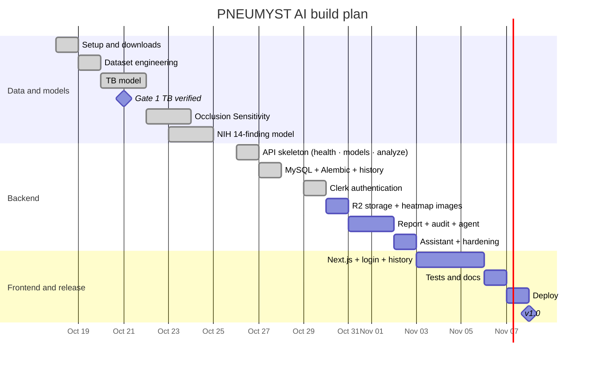

---

## ✅ Implementation ledger

| Feature | Status |
|---|:-:|
| Repository skeleton | ✅ Implemented |
| Environment and GPU check | ✅ Verified (PyTorch 2.11, CUDA 12.8, RTX 3050) |
| Data download and integrity checks | ✅ Verified (all archives, counts match official) |
| Dataset manifests and canonical labels | ✅ Tested |
| Duplicate and leak detection (all datasets) | ✅ Tested |
| Exploratory data analysis (23 sections) | ✅ Implemented |
| Image preprocessing (320 px) | ✅ Tested (121,141 images, 0 failures) |
| Training pipeline and augmentation | ✅ Tested (34 unit tests) |
| TB classifier | ✅ Tested (v2: Shenzhen-test 0.891, Montgomery 0.744) |
| NIH 14-finding classifier | ✅ Tested (official test mean AUROC 0.813) |
| Calibration and per-finding bands | ✅ Tested (frozen on validation) |
| Occlusion Sensitivity engine | ✅ Tested (43% of NIH boxes hit vs 8% chance; 10 unit tests) |
| Heatmap display rules | ✅ Tested (frozen) |
| Inference utility (both models → scores, bands, heatmaps) | ✅ Tested (matches the evaluated pipeline on 250 raw images; 12 unit tests) |
| Explanation cache and fallbacks | ⬜ Not started |
| Assistant agent (tool calling, read-only tools, report summary) | ⬜ Not started |
| FastAPI endpoints | ⏳ In progress (health, models, analyze, history ✅ verified in running app; report and ask planned) |
| Clerk authentication | ✅ Tested (19 auth tests; live 401 checks; real sign-in comes with the frontend) |
| MySQL schema and migrations | ✅ Verified in running app (Alembic `0001` on MySQL 8.0) |
| Cloudflare R2 storage | ⬜ Not started |
| Screening report (PDF) + audit record (JSON) | ⬜ Not started |
| Next.js dashboard and history | ⬜ Not started |
| Test suite (18 required cases + auth isolation + report checks) | ⬜ Not started |
| Deployment | ⬜ Not started |
| Localization (optional) | ⬜ Not started |

Statuses move through **Not started → In progress → Implemented → Tested → Verified in running app**. A feature is never marked complete just because code exists.

**Future model work:** TB v3 (chest-X-ray-pretrained weights after checking their training data, or multi-hospital training with balanced sampling) to close the Montgomery gap; Hernia validation; higher resolution for nodules; external radiologist-labelled tests (VinDr-CXR, CheXpert).

---

## ⚠️ Limitations

- Trained on public research data; performance on other hospitals, devices and populations is unknown until externally validated.
- NIH ChestX-ray14 labels were extracted from reports by NLP and contain errors, especially for pneumonia.
- Models may learn shortcuts (for example, chest drains for pneumothorax); heatmaps are used to check for this but cannot rule it out.
- Occlusion Sensitivity is a model-attribution aid, not a causal explanation and not clinical evidence. The hottest spot moves with patch size about half the time, so maps are shown as regions; localization is weakest for Pneumothorax (18% of boxes) and Atelectasis (23%).
- No prospective or clinical validation has been performed.
- The app does not yet check that an upload is a chest X-ray; any readable image of reasonable size and shape is scored.
- TBX11K classes differ strongly in acquisition statistics (brightness, contrast, sharpness), so internal TB scores may overstate real performance; the external Shenzhen / Montgomery test is the primary TB measure.
- TBX11K has no patient IDs, so two different scans of one patient could fall into different splits; only identical or near-identical images can be detected.
- Some findings have few or ambiguous training cases. Hernia has only 15 validation positives and is shown as insufficient data (its test AUROC of 0.901 on 86 cases suggests it could be enabled after proper validation); Infiltration (0.696) and Pneumonia (0.722) are the weakest findings.
- **TB at unfamiliar hospitals:** TB v2 thresholds were set on Shenzhen. On Montgomery, whose images look very different, the model ranks TB moderately (AUROC 0.744) but its calibrated scores run low, so only 38% of TB cases reach yellow or red. A site with different scanners needs local calibration before the TB result is relied on.
- **AP-view shortcut:** part of the NIH performance comes from the AP/PA view (e.g. Edema 0.850 overall but 0.779 on AP images). Results are reported per view; the heatmap border check found no sign that Edema relies on AP image borders or text.
- **Sicker test population:** on NIH's official test set more images turn red for findings the patient does not have (11–27% vs 10% on validation), because many test patients have other findings.
- The TB v2 split and calibration files were written before the test cell ran and were not changed afterwards, but they were committed together with the test results rather than in a separate commit beforehand.
- The NIH findings are evaluated on NIH's own NLP-derived test labels; external radiologist-labelled validation (VinDr-CXR, CheXpert) is future work.
- The account system is designed for a research prototype and has not been audited for clinical data protection standards.

## ⚕️ Medical disclaimer

PNEUMYST AI is for **research and education only**. It is not intended to diagnose, treat, cure or prevent any disease, and must not be used for clinical decision-making. Always consult a qualified healthcare professional.

---

## 🙏 Acknowledgements and citations

- **NIH ChestX-ray14** — data provided by the NIH Clinical Center. Download site: <https://nihcc.app.box.com/v/ChestXray-NIHCC>.
  Wang X. et al., *ChestX-ray8: Hospital-scale Chest X-ray Database and Benchmarks on Weakly-Supervised Classification and Localization of Common Thorax Diseases*, CVPR 2017.
- **TBX11K** — Liu Y. et al., *Rethinking Computer-aided Tuberculosis Diagnosis*, CVPR 2020.
- **Shenzhen and Montgomery** — Jaeger S. et al., *Two public chest X-ray datasets for computer-aided screening of pulmonary diseases*, Quant Imaging Med Surg, 2014. Provided by the U.S. National Library of Medicine.
- **CheXpert** — Irvin J. et al., *CheXpert: A Large Chest Radiograph Dataset with Uncertainty Labels and Expert Comparison*, AAAI 2019. Data provided by the Stanford Center for Artificial Intelligence in Medicine and Imaging (AIMI); see the AIMI dataset page for the required acknowledgement wording.

## 📄 License

Code in this repository is released under the [MIT License](LICENSE). Datasets are **not** included and remain under their own licenses and terms of use.

---

<div align="center">

Built with care for honest, explainable medical AI research.

</div>